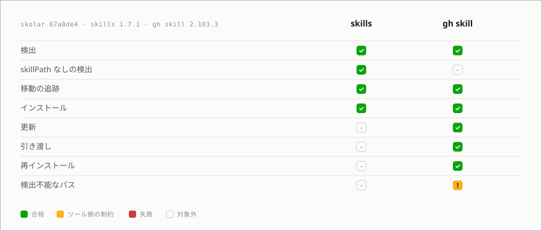
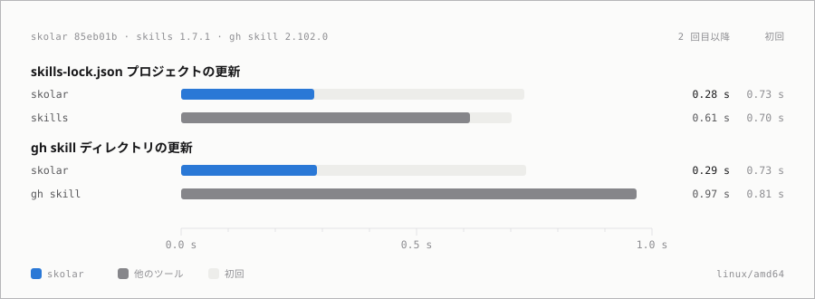

# skolar

プロジェクトで使う [Agent Skills](https://agentskills.io) を git リポジトリから取り込んで管理する。
[vercel-labs/skills](https://github.com/vercel-labs/skills) のロックファイルと [`gh skill`](https://cli.github.com/manual/gh_skill) のメタデータをどちらも読み書きする。



## インストール

[mise](https://mise.en.dev) でインストール

```sh
mise use -g packslip:github.com/h3y6e/skolar
```

または `go install` でインストール

```sh
go install github.com/h3y6e/skolar@latest
```

または [Releases](https://github.com/h3y6e/skolar/releases) からバイナリをダウンロードする。

## 使い方

```sh
skolar add h3y6e/spec-skills                 # 最新リリース (なければデフォルトブランチ)
skolar add h3y6e/spec-skills#main            # ref を固定する
skolar add -s 'spec-*' h3y6e/spec-skills     # 一部のスキルだけ
skolar add -d dot_agents/exact_skills ...    # 別のディレクトリ（既定は .agents/skills）
skolar list
skolar update                                # 上流の変更を確認してから適用する
skolar verify                                # ディスク上のファイルを記録と照合する
skolar remove spec-plan
```

## 記録の形式

skolar はインストールしたスキルの取得元を記録し、update や verify に使う。記録先は次のどちらかになる。

- 通常は各スキルの `SKILL.md` に `gh skill` と同じ形式のメタデータとして書き込む
- `skills-lock.json` のあるプロジェクトの `.agents/skills` では、vercel-labs/skills と同じロックファイルに書き込む

## 他のツールとの併用

### 互換性



### ベンチマーク



## ライセンス

[MIT](LICENSE)
